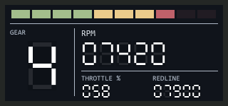

# Shift Lights - retro

**guysmiley222 - Shift Lights - retro** is a separate 320 × 150 overlay with the same lights and readouts as [Shift Lights](../Shift%20Lights/), restyled as a 1980s-style LCD instrument.



## Retro styling

Matches the other retro overlays: opaque charcoal bezel, square dark LCD face, thin row and column rules, and light seven-segment digits with faint inactive segments and subtle dark cells. The ten LEDs become square bars, with unlit bars dimmed to the same faint level. The gear shows as one large digit, using the conventional seven-segment `n` and `r` for neutral and reverse. RPM, throttle, and redline are segmented readouts with fixed leading zeroes. Monokai uses softer green digits alongside brighter green labels. Labels keep Consolas; no font installation is required.

## Install

Choose a `.simhubdash` from [themed/](themed/) using GitHub's **Download raw file** button. Double-click it to import into SimHub, then add the overlay to a Dash Studio overlay layout. Select iRacing and use windowed or borderless mode. It has its own dashboard identity, so it can coexist with the standard Shift Lights.

The six themed packages compile Current, VS Code Dark+, Dracula, Nord, Monokai, and Solarized Dark; the unsuffixed package is retained for compatibility.

## Behavior

The build imports the standard overlay's LED thresholds and readout formulas, so both variants behave identically: LEDs span 70–97% of the per-gear (or car) redline, all ten flash at redline, and missing data or a disconnected game shows dashes. See the [Shift Lights README](../Shift%20Lights/README.md#how-the-lights-work) for properties and details.

Hidden text items keep the standard formulas; segment opacity follows the same telemetry value. Gears other than `R`, `N`, and `1`–`9` leave the gear digit blank.

## Build and verify

From this folder in a checkout of the full repository:

```powershell
python .\build.py
powershell.exe -NoProfile -STA -ExecutionPolicy Bypass -File .\preview.ps1
python .\build.py
powershell.exe -NoProfile -STA -ExecutionPolicy Bypass -File .\verify.ps1
```

`verify.ps1` runs the standard Shift Lights checks against this folder, with the retro unlit level. It also decodes every seven-segment readout from its segment opacities and requires it to match the hidden text formula, including all gears, rounding, and missing and disconnected states. Preview images are static samples; the redline flash and segment rendering in SimHub need a practice-session check.
