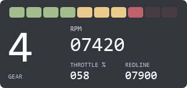

# Shift Lights

**guysmiley222 - Shift Lights** is a 320 × 150 overlay with a row of ten shift LEDs, a large gear indicator, and RPM, throttle, and redline readouts.



## Install

Choose a `.simhubdash` from [themed/](themed/) using GitHub's **Download raw file** button. Double-click it to import into SimHub, then add the overlay to a Dash Studio overlay layout. Select iRacing and use windowed or borderless mode.

## Choose a theme

Each build compiles Current, VS Code Dark+, Dracula, Nord, Monokai, and Solarized Dark into separate dashboards in [themed/](themed/). LEDs use each theme's success, warning, and danger colors, so green/yellow/red follow the palette. The unsuffixed package is retained for compatibility; use themed packages for theme selection.

## How the lights work

The LEDs span **70–97% of the redline** in 3% steps: four green, three yellow, and three red. They fill left to right as RPM rises. At or above the redline, all ten flash together using SimHub's `blink()` function — that is the shift cue.

| Value | Property |
| --- | --- |
| RPM | `DataCorePlugin.GameData.NewData.Rpms` |
| Redline | `CarSettings_CurrentGearRedLineRPM`, falling back to `CarSettings_RedLineRPM` |
| Gear | `DataCorePlugin.GameData.NewData.Gear` (`N`, `R`, `1`…) |
| Throttle | `DataCorePlugin.GameData.NewData.Throttle` (0–100) |

The redline comes from SimHub's car settings, including any per-gear override you set there. The **REDLINE** readout shows the value in use, so you can confirm it matches the car. If SimHub reports no redline, the LEDs stay dark and the readout shows `-----` rather than guessing.

Numbers use fixed-width leading zeroes (`07420`, `058`) in the same style as the lap timers. Missing or out-of-range values and a disconnected or non-iRacing game show placeholders, and the header reads **Waiting for iRacing**.

## Build and verify

From this folder in a checkout of the full repository:

```powershell
python .\build.py
powershell.exe -NoProfile -STA -ExecutionPolicy Bypass -File .\preview.ps1
python .\build.py
powershell.exe -NoProfile -STA -ExecutionPolicy Bypass -File .\verify.ps1
```

`verify.ps1` evaluates the generated expressions with SimHub's installed NCalc engine: every LED threshold from both sides, left-to-right fill, both flash phases at redline, redline fallback and unknown redline, missing and out-of-range data, and disconnect/recovery. It also loads all six themed packages with SimHub's models and checks identities, bounds, and thumbnails. `blink()` is emulated in that check; preview images are static samples.

For acceptance, drive a practice session and confirm the LEDs fill smoothly, the flash rate feels right at redline, the REDLINE readout matches the car, and gears show `R`/`N` correctly.
